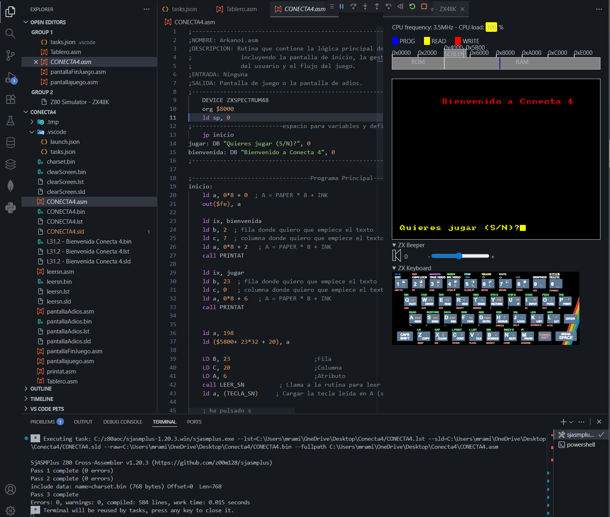

# Conecta 4 para ZX Spectrum

Conecta 4 escrito en ensamblador Z80 para el ZX Spectrum 48K. Es una práctica de la asignatura AOC del Grado en Ingeniería Informática de la Universidad Francisco de Vitoria (2025).



**Tecnologías:** ensamblador Z80 · sjasmplus · DeZog (simulador ZX48K en VS Code)

## Estado

El juego está a medias. Funcionan la pantalla de bienvenida, el dibujo del tablero, el movimiento de la ficha por las columnas, el cambio de jugador y las pantallas de fin de partida y despedida. Faltan soltar la ficha en el tablero y comprobar si hay cuatro en raya.

## Controles

| Tecla | Acción |
|---|---|
| S / N | Empezar a jugar o salir |
| Q / W | Mover la ficha a la izquierda o a la derecha |
| ENTER | Cambiar de jugador (amarillo o rojo) |
| F | Terminar la partida |

## Cómo funciona

El programa se carga en `$8000` y escribe directamente en la memoria de vídeo del Spectrum: los píxeles en `$4000` y los atributos de color en `$5800`. El teclado se lee por los puertos de la ULA con `IN A, (C)`, una fila de teclas por puerto (`$FBFE` para Q y W, `$FDFE` para F, `$BFFE` para ENTER).

El tablero se guarda en memoria como 7 columnas de 6 casillas. Cada casilla vale 0 si está vacía o el código de color del jugador que la ocupa.

| Fichero | Contenido |
|---|---|
| `CONECTA4.asm` | Programa principal: bienvenida y pregunta S/N |
| `Tablero.asm` | Tablero, movimiento de la ficha y lectura del teclado |
| `pantallajuego.asm` | Bucle principal de la partida |
| `pantallaFinJuego.asm`, `pantallaAdios.asm` | Pantallas de fin de partida y despedida |
| `printat.asm` | Rutinas para escribir texto en una fila y columna con un color |
| `leersn.asm` | Espera a que se pulse S o N |
| `charset.bin` | Juego de caracteres |

## Ensamblar y ejecutar

Con [sjasmplus](https://github.com/z00m128/sjasmplus):

```bash
sjasmplus --raw=CONECTA4.bin --sld=CONECTA4.sld CONECTA4.asm
```

Para ejecutarlo, abre la carpeta en VS Code con la extensión DeZog y lanza la configuración **Simulator** de `.vscode/launch.json`. Carga `CONECTA4.bin` en `$8000` en un ZX Spectrum 48K simulado.
